<p align="center">
  
</p>

<p align="center">
  <a href="https://git.io/typing-svg">
    
  </a>
</p>

<p align="center">
  
  
  
  
  
  
</p>

<div align="center">

[✨ Fitur Utama](#-fitur-fitur-unggulan) &nbsp;•&nbsp; 
[📱 3D Studio](#1--interactive-real-time-3d-smartphone-viewport) &nbsp;•&nbsp; 
[🍱 Bento Studio](#3--zero-gap-bento-studio-architecture) &nbsp;•&nbsp; 
[🎮 Kontrol 3D](#-navigasi--kontrol-3d-viewport) &nbsp;•&nbsp; 
[🛠️ Tech Stack](#️-tech-stack--library) &nbsp;•&nbsp; 
[🚀 Quick Start](#-menjalankan-project-secara-lokal) &nbsp;•&nbsp; 
[📁 Struktur Folder](#-struktur-direktori-project)

</div>

---

## 🌟 Tentang ProRent Studio

**ProRent Studio** adalah platform web modern untuk penyewaan lini *flagship smartphone* iPhone resmi dan profesional. Didesain dengan doktrin estetika **Apple Studio Minimalist Titanium**, situs ini memadukan rendering 3D real-time WebGL, efek partikel astronomi kosmik dinamis, tata letak bento *zero-gap*, dan kalkulator simulasi sewa instan.

Platform ini dirancang khusus untuk memenuhi kebutuhan sewa profesional:
* 🎬 **Content Creator & Videographer** (ProRes LOG 4K, tripod kit, wireless mic)
* 🎸 **Penonton Konser & Festival Musik** (Zoom periskop 5x optic & audio ultra-clear)
* 💍 **Dokumentasi Event & Wedding** (Warna natural skin-tone & portabilitas tinggi)
* ✈️ **Traveler & Liburan Internasional** (Baterai tahan lama & perlindungan all-inclusive)

---

## ✨ Fitur-Fitur Unggulan

### 1. 📱 Interactive Real-Time 3D Smartphone Viewport
* **Three.js & GLTF 3D Engine**: Menampilkan model 3D iPhone 15 Pro otentik lengkap dengan 4 varian warna titanium (*Natural, Blue, White, dan Black Titanium*).
* **Rotasi 360° Interaktif**: Dilengkapi navigasi drag sentuh/mouse, auto-spin halus, dan reset sudut pandang.
* **Studio Angle Presets**: Pilihan sudut kamera sinematik instan:
  * 📦 `Isometric`: Sudut studio 3/4 ikonik.
  * 📱 `Front`: Tampilan depan Super Retina XDR & Dynamic Island.
  * 🧭 `Dynamic`: Perspektif miring dinamis.
  * 🛡️ `Back`: Detail kamera 48MP Photonic & backplate titanium.
* **Dynamic Camera Clearance**: Algoritma optik dinamis `getOptimalHeroCameraZ` yang memastikan ponsel memiliki jarak visual lega (>65px) di semua resolusi layar tanpa menabrak dock UI.

### 2. 🪐 Cosmic Astronomy Background Engine
* Latar belakang kosmik hidup dengan ribuan bintang berkedip (*twinkling starfield*) dan lintasan meteor acak (*shooting stars*).
* Otomatis beradaptasi secara mulus antara **Midnight Cosmic Dark Mode** dan **Pure Frost Studio Light Mode**.
* Menggunakan akselerasi Canvas 2D untuk efisiensi CPU/GPU (60 FPS stabil).

### 3. 🍱 Zero-Gap Bento Studio Architecture
* **Tata Letak 5-Kartu Simetris**: Mengisi penuh ruang 3x2 tanpa menyisakan *dead space*:
  * 🎸 *Paket Konser & Festival VIP* (Hero Featured)
  * 🎬 *Paket Cinematic Creator 4K*
  * 💍 *Paket Wedding & Event Duo*
  * ✈️ *Paket Holiday & Travel Creator*
  * 🛠️ *Studio Custom Rig & Concierge On-Demand* dengan selector gear interaktif.
* **Bento Trust Strip**: 4 pilar jaminan garansi studio (Antar-Jemput, Battery Health 100%, Garansi Swap Kilat, Bebas Deposit Rumit).
* **5 UI Variations**: Beralih instan antara Bento Studio, Tabbed Stage, Tier Columns, Editorial Reel, dan Swiss List.

### 4. 🧮 Interactive Rental Duration & Cost Calculator
* Slider durasi sewa harian hingga bulanan.
* Kalkulasi diskon progresif otomatis dan rincian jaminan transparan.
* Keranjang sewa *slide-in drawer* dengan penyimpanan lokal (`localStorage`).

### 5. 📱 100% Responsive di Semua Perangkat
* Diuji dan dioptimalkan secara presisi untuk:
  * 🖥️ **Desktop Ultra-wide & Standar** (1440px - 1920px+)
  * 💻 **Laptop Menengah** (1025px - 1200px)
  * 📱 **Tablet & iPad** (768px - 1024px)
  * 📱 **Smartphone** (360px - 480px) dengan *native mobile bottom navigation bar*.

---

## 🎮 Navigasi & Kontrol 3D Viewport

| Aksi | Mouse / Touch Gesture | Keterangan |
| :--- | :--- | :--- |
| **Putar Bebas 360°** | Klik kiri / Touch Drag | Memutar orientasi smartphone secara halus |
| **Zoom In / Out** | Mouse Wheel / Pinch Zoom | Memperbesar detail lensa atau body titanium |
| **Preset Sudut** | Klik tombol preset (Isometric / Front / Dynamic / Back) | Transisi kamera sinematik mulus |
| **Ganti Warna Titanium** | Klik tombol color swatch (Natural / Blue / White / Black) | Merubah tekstur material real-time |
| **Auto-Spin** | Klik tombol Orbit / Auto Spin | Rotasi otomatis berkelanjutan 360° |

---

## 🛠️ Tech Stack & Library

* **Core**: Semantic HTML5, Vanilla JavaScript (ES6+), Vanilla CSS3 (Custom Properties & Glassmorphism).
* **3D & Graphics**: [Three.js](https://threejs.org/) (WebGL), `GLTFLoader`, `DRACOLoader`.
* **Animasi**: [GSAP (GreenSock)](https://greensock.com/), CSS3 Keyframes.
* **Icons & Typography**: [FontAwesome 6](https://fontawesome.com/), Google Fonts (*Plus Jakarta Sans*, *Outfit*).

---

## 📁 Struktur Direktori Project

```text
iphone-flagship-rental-experience/
├── index.html               # Semantic HTML markup & layout
├── style.css                # Titanium glassmorphism & responsive CSS
├── script.js                # Three.js 3D engine, cosmic particles, bento logic
├── banner.svg               # Native SVG animated banner (GitHub Camo compatible)
├── iphone.glb               # 3D Model iPhone 15 Pro
├── DRACOLoader.js           # Draco geometry decompressor for Three.js
├── GLTFLoader.js            # Three.js GLTF/GLB model loader
├── draco/                   # Draco decoder wasm binaries
│   ├── draco_decoder.js
│   ├── draco_decoder.wasm
│   └── draco_wasm_wrapper.js
├── previewed_*.png          # Asset preview & marketing mockups
├── .gitignore               # Git exclusion rules
└── README.md                # Dokumentasi lengkap project
```

---

## 🚀 Menjalankan Project Secara Lokal

1. **Clone repository ini:**
   ```bash
   git clone https://github.com/fallss/iphone-flagship-rental-experience.git
   cd iphone-flagship-rental-experience
   ```

2. **Jalankan local web server:**
   
   Menggunakan Python:
   ```bash
   python3 -m http.server 8899
   ```

   Atau menggunakan Node.js `serve` / `npx`:
   ```bash
   npx serve .
   ```

3. **Buka di browser:**
   Akses `http://localhost:8899` pada browser pilihan Anda.

---

<p align="center">
  Didesain dengan presisi dan standar estetika modern • © 2026 ProRent Studio.
</p>
